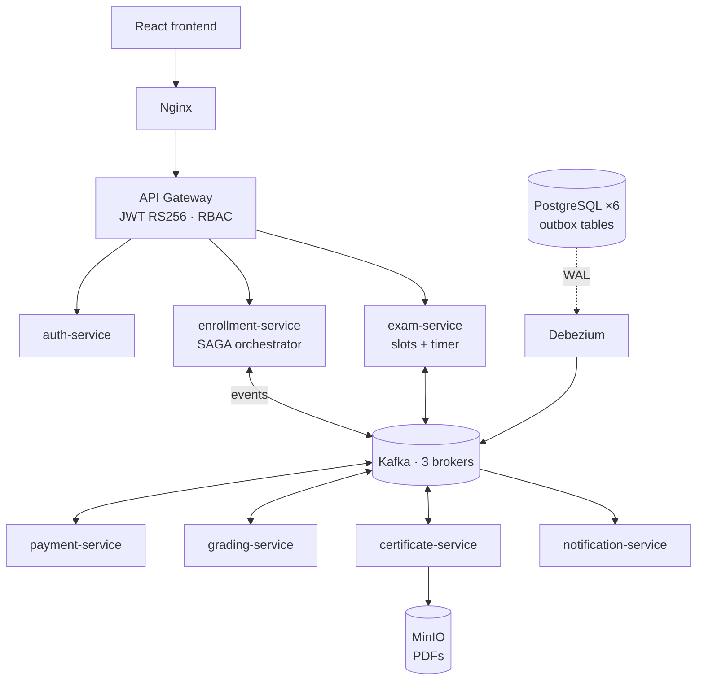
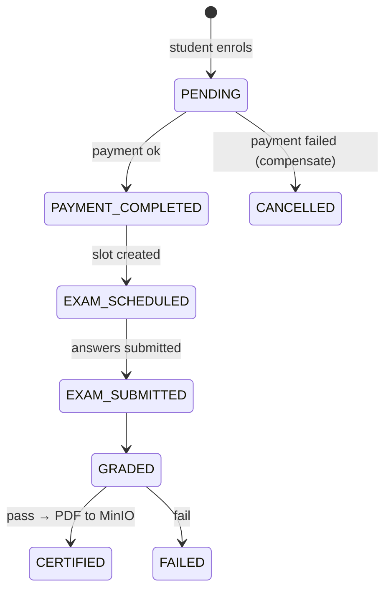

<div align="center">

# 🎓 Online Exam & Certification Platform

**Event-driven microservices platform — enrol, pay, sit a timed exam, get auto-graded
and download a verifiable PDF certificate. Orchestrated end-to-end with the SAGA pattern over Kafka.**


</div>

<!-- TODO: add 2–3 screenshots (exam runner, certificate PDF, Kafka UI showing the SAGA events):
 -->

## Why it's interesting

A "simple" enrol → pay → exam → certificate flow touches six services and six databases. The hard
part isn't the CRUD — it's keeping that flow **consistent without distributed transactions**
when any step can fail. This project solves that with production patterns:

- **SAGA orchestration** — the enrollment service drives the workflow and issues
  **compensating actions** (e.g. payment failure → enrollment cancelled).
- **Transactional Outbox + Debezium CDC** — events are written in the same DB transaction as the
  state change, then streamed from the PostgreSQL WAL to Kafka. No dual-write, no lost events.
- **Database-per-service** — 6 isolated PostgreSQL instances; services share events, never tables.
- **RS256 JWT at the gateway** — asymmetric keys; only the auth service can sign, every service
  can verify. Role-based access for students and admins.
- **Pre-signed MinIO URLs** for certificate downloads, each with a unique verification code.

## Architecture



### The SAGA



## DevOps pipeline

| Stage | Tool | What happens |
|---|---|---|
| Build & test | GitHub Actions | Maven build (Java 21) with dependency cache |
| Quality gate | SonarQube (self-hosted runner) | Static analysis on every push |
| Package | GitHub Actions → GHCR | Docker images tagged with the git SHA |
| Deploy | Jenkins | Pull from GHCR → staging → smoke tests → **manual approval** → production tag → health check |

Why two CI tools, why a self-hosted runner, and every other trade-off is explained in
[`TECHNICAL.md`](TECHNICAL.md).

## Tech stack

**Backend** Java 21 · Spring Boot · Spring Cloud Gateway · **Messaging** Apache Kafka (3 brokers) ·
Debezium · **Data** PostgreSQL ×6 · MinIO · **Frontend** React · TypeScript · Vite ·
**Infra** Docker Compose · Nginx · **CI/CD** GitHub Actions · Jenkins · SonarQube · GHCR

## Quick start

```bash
./scripts/generate-jwt-keys.sh      # creates keys/ (git-ignored)
docker compose up -d --build        # 26 containers
./register-connectors.sh            # Debezium CDC connectors
# Frontend: http://localhost:20000 · Kafka UI: http://localhost:8088
```

Full step-by-step guide, Postman collection and troubleshooting: [`SETUP.md`](SETUP.md).

---

Built for EC7205 Cloud Computing, University of Ruhuna (2026).
**G.W. Niranga Niluminda** · [LinkedIn](https://linkedin.com/in/niranganiluminda)
